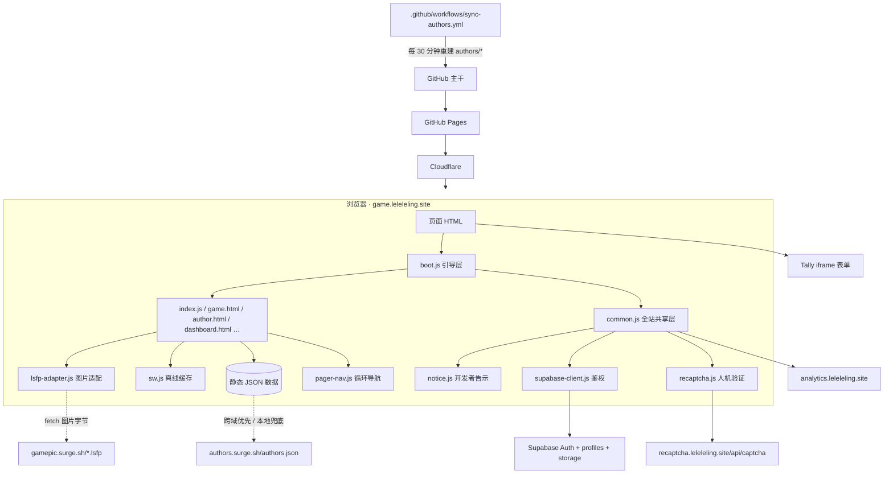

# foraisthings.md · 了了了游（lelele Game）项目接手手册

> **读者**：一个对本仓库**零上下文**的 AI（或人类协作者）。通读本文后，你应该能独立理解架构、数据契约、前后端边界、部署链路、历史遗留问题，并安全地接手任何改造任务。
> **维护**：本文件由 AI 维护，描述「项目**现在**是什么样」。每次大改动完成后，更新本文相关章节，并在 `historymd/` 新增一篇记录（见 0.3）。
> **版本基准**：2026-11-12 · 站点 `4.1.0` ·《游戏守则》`5.0.0` · SW 缓存 `lelele-pwa-v1.11` · 30 款游戏 / 9 位作者。
> **准确性**：本文所有标识符、常量、字段、域名、表单 ID 均逐文件核实过。行号会随改动漂移，故正文以「文件 + 函数名 / 常量名」定位，不依赖行号。若发现描述与代码冲突，**以代码为准**并顺手修正本文。

---

## 0. 如何阅读本手册与工作约定

### 0.1 三十秒速览

了了了游是「了了了岭工作室」旗下的**纯静态 HTML5 小游戏聚合导航站**：打开网页即玩，主打工作间隙摸鱼。没有构建步骤、没有前端框架、没有服务端渲染。仓库里的 `.html` / `.js` / `.css` / `.json` 推到 GitHub 主干后由 GitHub Pages 直接发布，Cloudflare 加速，域名 `game.leleleling.site`。

「后端」是若干**外部服务**（Supabase、自建 reCAPTCHA 验证服务、Tally、Edgemetry/Umami、Surge 静态源），本仓库**只有调用它们的浏览器端代码**，不含任何服务端源码。详见第 5 章。

### 0.2 文档体系与互相指引

| 文件 | 定位 | 是否进 git |
| --- | --- | --- |
| `foraisthings.md`（本文） | **接手总手册**：现状、架构、数据契约、SOP、已知坑 | ✅ 已被 git 跟踪，随 push 同步 |
| `historymd/*.md` | **里程碑记录**：每次大改动一篇，写「改了什么、为什么、怎么验证」 | ❌ 被 `.gitignore` 忽略，**仅本地可见** |
| `thoughts.md` | **升级点子库**：185 条分级待办（10 大 / 25 中 / 50 小 / 100 迷你），含优化、新功能、修 bug；与「已修档案」`plan.md` 相对 | ✅ |
| `plan.md` | 4.0.14 审计基线产生的 170 项全站问题清单，状态已全标「本轮已修」，属**历史档案** | ✅ |
| `AUTHOR_CERTIFICATION.md` | 官方认证等级规则（Lv.1–6）、徽章定义、申请流程 | ✅ |
| `GAME_ENTRY_TEMPLATE.md` | 给 AI 用的「新增外网游戏 JSON 输出规范」（含中英分类对照、视频规则、完整示例） | ✅ |
| `README.md` | 面向访客的项目简介 | ✅ |
| `LSFP-NOTICE.txt` | 内置 `lsfp.js` 的上游 NOTICE + Apache-2.0 全文，合规留存 | ✅ |
| `github/vertified-application-form.md` | 认证申请表相关留档 | ✅ |
| `github/admin.html` | 站长**内部**管理控制台（可公开部署，但仅站长持 PAT 可用）：选动作 → 填空/选题 → 预览 → 触发 Action 落库；文件零密钥、PAT 只存浏览器 | ✅ |
| `.github/workflows/admin-apply.yml` | 监听 `repository_dispatch` 的 `admin-apply` 事件，校验并生成静态 JSON，默认开草稿 PR 或直接推送 | ✅ |
| `.github/scripts/admin-apply.mjs`（+`.test.mjs`） | 按动作分派：字段校验 + 最小差异写入；Node 单测覆盖 | ✅ |

> ⚠️ **历史纠错**：旧版本文曾写「`foraisthings.md` 已被 `.gitignore` 忽略、不会推送」以及「仓库没有 `.gitignore`」。**这两条现在都不成立**：`foraisthings.md` 已被 git 跟踪并会随 push 同步；仓库根目录现有 `.gitignore`，内容只忽略 `historymd/` 与 `.DS_Store`。**不要把 `foraisthings.md` 加进忽略规则**，否则零上下文的远端 AI 就看不到这本手册。

### 0.3 里程碑记录机制（`historymd/`）

用户要求：像 GitHub 的历史一样留痕，但**按「一次大改动」计，不按每次 commit 计**。

- **目录**：`historymd/`，已被 `.gitignore` 忽略，不随 push 同步。若将来需要团队共享，需移除忽略规则并单独提交。
- **命名**：`YYYY-MM-DD-简短主题.md`（小写英文/连字符，例 `2026-11-12-pager-nav-and-ai-handbook.md`）。
- **必备字段**：日期 / 主题 / 触发 / 版本口径 / commit hash；正文五节：动机、涉及文件（表格）、关键决策与理由（写清为什么不选另一条路）、**可量化的**验证结果、遗留事项。
- **模板**：见 `historymd/2026-11-12-pager-nav-and-ai-handbook.md` 末尾「附录：记录模板」，直接复制。
- **什么算「大的改动」**：跨多文件的功能新增、架构或数据结构调整、影响全站的样式/缓存策略变更、合规规则升级、一次集中修复多个问题。
- **什么不算**：单条文案修正、单个 JSON 字段调整、纯 refactor 无行为变化、常规新游戏收录（那个走 7.1 的 SOP 即可，不必写 md）。
- **本手册的职责边界**：本文只写「现状」，不要把流水账堆进来；每次改动的历史放 `historymd/`，本文第 10 章只保留压缩索引。

### 0.4 项目铁律（违反会出事）

1. **零框架零构建**：不引入 React/Vue/打包器/npm 运行时依赖。改完即上线。
2. **颜色只走设计令牌**：`common.css` 的 `:root` 与 `html.dark-mode` 变量，禁止在散落处写死 hex（少数 tooltip/骨架等纯装饰例外）。
3. **文案中英双语**：`.zh-inline` / `.en-inline`（行内）、`.zh-text` / `.en-text`（块级），或 JS 里用 `isEn()` / `data-lang` 判断。
4. **站内资源与链接一律根绝对路径**（`/common.css`、`/index.html`）。这是 404 页与子目录 URL 踩过大坑后的硬规则，详见 8.1。唯一例外：`game/` 子目录里的同目录资源（`style.css` / `game.js`）保持相对。
5. **用户提交内容必须消毒**：公告富文本走 `common.js` 的 `sanitizeAnnouncementHtml()`；协议链接走 `game.html` 的 `safeLegalUrl()`；动态名称一律 `textContent` 或 `escapeHtml()`。
6. **隐私最小化**：投稿/认证申请里的联系邮箱、个人官网、资质截图**不写进公开仓库**。仓库只落公开的等级、作品、署名。
7. **commit 但不 push**：本仓库的约定是改完提交到本地，由用户自行 push。不要替用户 push，也不要擅自暂存/提交工作区里用户自己的改动。
8. **版本号双轨**：见 9.1，站点版本与规则版本是两个东西。

### 0.5 自检：如何确认本文还没过时

```bash
cd /Users/david/Documents/GitHub/lelele-game
git --no-pager log --oneline -12                     # 最近大改动
python3 -c "import json;g=json.load(open('lelegame_data.json'));print(len(g),max(x['id'] for x in g))"
python3 -c "import json;a=json.load(open('authors/index.json'));print(len(a),[x['id'] for x in a])"
grep -n "CACHE_NAME" sw.js
python3 -c "import json;c=json.load(open('changelog.json'));print(c[0]['version'],len(c))"
grep -n "版本 5.0.0" game_rules.html
git check-ignore -v historymd/ && git ls-files --error-unmatch foraisthings.md
grep -c "了了了游官方版" legal_generic.js generic_eula.html generic_privacy.html generic_tos.html
grep -cE '^[0-9]+\.|^\| [0-9]+ \|' thoughts.md    # 应为 185
```

---

## 1. 架构总览

### 1.1 技术栈

| 层 | 技术 | 说明 |
| --- | --- | --- |
| 页面 | 原生 HTML + 内联 `<script>` | 25 个根页面 + `game/` 下 12 个游戏页 |
| 样式 | `common.css`（全局令牌/组件）+ `effects.css`（特效）+ 各页内联 `<style>` | 苹果风：留白、毛玻璃、pill 按钮、圆角 |
| 逻辑 | 原生 JS，IIFE + `window.*` 全局 | 无模块打包，`defer` 与 `boot.js` 的 `onReady` 控制时序 |
| 数据 | 静态 JSON 文件 | 手改 + GitHub Actions 自动生成 + 跨域 Surge 源 |
| 账号 | Supabase Auth + Postgres `profiles` | 仅开发者生态（登录/后台/认证/资料） |
| 表单 | Tally iframe 嵌入 | 投稿/推荐/认证申请/更新游戏/反馈 |
| 统计 | Edgemetry（主）+ Umami（回退） | `leleleTrack()` 统一埋点；排行榜从 analytics API 取数 |
| 离线 | Service Worker + manifest | 三分支缓存策略，见 4.12 |
| 图片 | 自研 LSFP 格式 + 旧图回退 | 见 4.9 与 8.5 |
| 部署 | GitHub Pages + Cloudflare，CNAME | 纯静态，push 即发布 |

### 1.2 系统关系图



### 1.3 页面加载时序（很重要，改脚本顺序必读）

1. `<head>` 里一段**早期内联脚本**读 `URLSearchParams`，设定 `document.documentElement[data-lang]` 防语言闪烁。
2. `<script src="/boot.js"></script>` **同步**（无 defer），立刻建立 `window.leleleFetch` / `onReady` / `loadScript` 等基础设施。
3. `<script defer src="/vendor/supabase-js.js">` 等第三方 UMD。
4. 页面 body 末尾按序引入 `defer` 脚本：`/common.js` → `supabase-client.js` → `/lsfp-adapter.js` → `/notice.js` → `legal_generic.js` → `/pager-nav.js`（仅详情页/作者页）。
   - ⚠️ **`lsfp-adapter.js` 必须在 `notice.js` 之前**，因为告示弹窗的图片要靠适配层水合。
   - ⚠️ `supabase-client.js` 必须在依赖 `supabaseClient` 的脚本之前。
5. **页面内联 `<script>`（同步）**里把初始化包在 `window.onReady(() => …)` 中。`defer` 脚本会在 `DOMContentLoaded` 之前执行完，因此 `onReady` 回调触发时所有全局都就绪。
6. `boot.js` 在 `onReady` 后异步注入 `https://analytics.leleleling.site/em.js`（`data-domain=game.leleleling.site`），失败静默。

### 1.4 三个版本口径（切勿混淆）

| 口径 | 当前值 | 权威位置 | 说明 |
| --- | --- | --- | --- |
| **站点版本** | `4.1.0` | `changelog.json` 数组第 1 条 | 三段式 `主.中.微`，规则见 9.1 |
| **规则版本** | `5.0.0` | `game_rules.html` 版本头 | 《游戏守则》，2026-11-15 生效；**不是站点版本** |
| **SW 缓存名** | `lelele-pwa-v1.11` | `sw.js` 的 `CACHE_NAME` | 只是缓存版本号，改字节才升，与上面两个无关 |

历史快照：`game_rules4-0-0.html` / `game_rules4-0-1.html` / `game_rules4-0-2.html`，由 `game_rules.html` 页尾「📚 历史版本」索引互相链接。

### 1.5 域名与外部服务一览

| 域名 | 用途 | 谁写它 |
| --- | --- | --- |
| `game.leleleling.site` | 主站（CNAME 文件内容即此 HTTPS URL） | 本仓库 |
| `gamepic.surge.sh` | 图片床，存 `.png/.PNG/.jpg/.jpeg` 旧图与 `.lsfp` 新图；根目录有 `CORS` 文件（内容 `*`） | 用户手工 `surge` 部署 |
| `authors.surge.sh` | **作者清单权威源** `authors.json` | 用户在 Surge 维护 |
| `recaptcha.leleleling.site` | 自建人机验证服务 `/api/captcha/*` | 外部 Vercel 项目，**源码不在本仓库** |
| `analytics.leleleling.site` | Edgemetry 统计 + 排行榜 API | 外部服务 |
| `mynsjlquktwucqlmfmxf.supabase.co` | Supabase 项目 | 外部 Supabase |
| `tally.so` | 表单嵌入 | 外部 Tally |
| `lsfp.leleleling.site` / `cdn.jsdelivr.net/gh/LelelelingStudio/lsfp@main/lsfp.js` | 上游 LSFP 解码库（本仓库已内置，运行时不依赖） | 上游仓库 |

---

## 2. 完整文件职责表

### 2.1 根目录 HTML（25 个）

| 文件 | 用途 |
| --- | --- |
| `index.html` | 首页：游戏网格、类型/分类筛选、搜索、收藏、排行榜、公告、投稿/推荐弹窗 |
| `game.html` | 游戏详情页：横幅、截图、简介、更新日志、作者栏、收藏、开始游戏、协议侧栏、灯箱、循环导航 |
| `author.html` | 作者主页：作者资料、徽章、名下游戏列表、循环导航 |
| `authorlevel.html` | 认证等级说明（Lv.1–6） |
| `apply-certification.html` | 开发者官方认证申请（Tally 表单） |
| `dashboard.html` | 开发者后台：资料编辑、头像上传、收藏管理、更新游戏、认证申请入口、数据看板 |
| `login.html` | 开发者登录/注册（邮箱 + OAuth + 密码找回） |
| `about.html` | 关于我们 + `changelog.json` 渲染 |
| `docs.html` | 站点导航 / 文档中心 |
| `developer_docs.html` | 开发者文档 |
| `sitemap.html` | 人类可读站点地图 |
| `gamecheck.html` | 游戏实时数据看板（analytics API） |
| `404.html` | GitHub Pages 404 页（含 `<base href="/">` 与全 fallback，见 8.1） |
| `game_rules.html` | 《游戏守则》当前版 5.0.0 |
| `game_rules4-0-0.html` / `game_rules4-0-1.html` / `game_rules4-0-2.html` | 规则历史快照 |
| `user_agreement.html` | 平台用户协议（已区分官方游戏与第三方游戏的责任主体） |
| `legal_templates.html` | 协议模板中心：三套中英模板 + Markdown/TXT/HTML/Word/PDF 五种导出 |
| `generic_eula.html` / `generic_privacy.html` / `generic_tos.html` | 平台「官方版」法律协议三个静态页（官方游戏适用 + 未提交专属协议的游戏兜底） |
| `privacy.html` / `terms.html` / `copyright.html` | 平台自身合规页 |

### 2.2 根目录 JS

| 文件 | 职责 | 对外全局 |
| --- | --- | --- |
| `boot.js` | 引导层：脚本加载、统一 fetch 超时、作者清单、Tally iframe、日志、内联事件提升、analytics 注入 | `loadScript` `leleleFetch` `onReady` `fetchAuthorsLocal` `fetchAuthorsFresh` `fetchAuthors` `mountTallyIframe` `leleleLog` `leleleLiftInlineClicks` `leleleLastAuthorsError` |
| `common.js` | 全站共享层（最大，约 78 KB）：多语言、主题、灵动岛、公告、认证徽章、埋点、鉴权注入、PWA、冬季雪天、设置面板 | `leleleTrack` `leleleAuthorBadges` `LELELE_AUTHOR_LEVELS` `setLang` `toggleTheme` `sanitizeAnnouncementHtml` `escapeHtml` `fetchAuthors*` 等 |
| `index.js` | 首页逻辑：列表/筛选/搜索/分页/收藏/预览/投稿/排行榜/随机游玩 | `openModal` `closeModal` `removeFavorite` `renderGames` `toggleFavFromPreview` |
| `search.js` | 拼音/首字母搜索与高亮 | `leleleSearch` `leleleSearchAuthors` |
| `notice.js` | **开发者专用定向告示**：登录态 → 作者身份 → 过滤 → 队列弹窗 | `leleleShowNotices` |
| `rank-loader.js` | 独立排行榜模块（IIFE，不暴露全局） | — |
| `legal_generic.js` | **官方版协议**纯常量「单一数据源」（中英 × 三类，含 `liability` 责任声明字段） | `LELELE_GENERIC_AGREEMENTS` `LELELE_LEGAL_ATTRIBUTION` |
| `lsfp.js` | 内置上游 LSFP v2.0.0 解码/编码器（Apache-2.0） | `LSFP` / `window.LSFP` |
| `lsfp-adapter.js` | LSFP 图片集中适配层：fetch → decode → canvas → Blob URL → 失败回退 | `LeleleLsfp` |
| `pager-nav.js` | 详情页/作者页循环导航（2026-11-12 新增） | `LelelePager` |
| `supabase-client.js` | 仅创建 Supabase client（12 行，硬编码 URL/anon key） | `supabaseClient` |
| `recaptcha-config.js` | reCAPTCHA 配置常量 | `LELELE_RECAPTCHA_CONFIG` |
| `recaptcha.js` | 人机验证全流程（531 行） | `LeleleCaptcha` |
| `sw.js` | Service Worker | — |

### 2.3 其它根目录文件

| 类别 | 文件 |
| --- | --- |
| 样式 | `common.css`（全局）、`effects.css`（特效）、`recaptcha.css` |
| 数据 JSON | `lelegame_data.json` `announcements.json` `noticetodeveloper.json` `activity_whole.json` `special_common.json` `changelog.json` `manifest-zh.json` `manifest-en.json` |
| 部署/SEO | `CNAME` `robots.txt` `sitemap.xml` `.gitignore` `sw.js` |
| PWA 图标 | `icon-192.png` `icon-512.png` `favicon.ico` `favicon-winter.ico` |
| 素材 | `lelelegame.svg` / `.png` / `.pdf`、`background-winter.png`、`winter-banner.png` `winter-snowman.png` `winter-tree.png`、`lelelegame-winter.png`、3 张 `截屏2026-11-04…png` |
| 许可/合规 | `LICENSE` `LSFP-NOTICE.txt` |
| 编辑器 | `lelele-game.code-workspace` |
| 文档 | `foraisthings.md` `thoughts.md` `plan.md` `AUTHOR_CERTIFICATION.md` `GAME_ENTRY_TEMPLATE.md`（定位见 0.2） |

### 2.4 子目录

- `game/data/` — **30 个** `1.json`–`30.json`，每个是一款游戏的详情数据（见 3.3）。
- `game/<slug>/` — 12 个本地游戏本体目录，各含 `index.html`（+ 同目录 `style.css` / `game.js` 等）：`2048_1`、`3Dshooting`、`MCpointygame`、`deleting_bombs`、`eat_planet`、`happycorn`、`leveleating`、`old_happyfarmer`、`popping_banana`、`space_shooting`、`universal_evolution`、`others/2026_7_7/point_the_button`。这些页面通过 `https://game.leleleling.site/common.js` 引全站脚本。
- `authors/` — `index.json`（9 条）+ `data/1.json`–`data/9.json`（各 `{"games_count": n}`）。**由 GitHub Actions 生成，不要手改**。
- `vendor/` — 自托管 UMD：`supabase-js.js`、`pinyin-pro.js`、`echarts.min.js`（4.0.12 起，当前**在用**，旧手册说「已 revert」是错的）。
- `.github/workflows/` — 工作流：`sync-authors.yml`（每 30 分钟从 surge 同步作者，见 5.8 / 6.2）、`admin-apply.yml`（监听 `repository_dispatch`，由 `github/admin.html` 触发，校验并落库静态 JSON，见 4.14）。
- `.github/scripts/admin-apply.mjs`（+`.test.mjs`）— `admin-apply.yml` 调用的校验/生成脚本，纯 Node 内置模块，不依赖第三方包。
- `github/` — `vertified-application-form.md` 留档；`admin.html` 是站长内部管理控制台（见 4.14），可公开部署，不进玩家导航。
- `historymd/` — 里程碑记录，被忽略，见 0.3。

### 2.5 脚本引入矩阵

| 脚本 | 引入范围 |
| --- | --- |
| `boot.js` | 23 个根页面（`authorlevel.html`、`sitemap.html` 不引） |
| `common.js` | 根目录 20 页 + `game/` 12 页全部；`dashboard.html` `login.html` `gamecheck.html` `game_rules4-0-0.html` `sitemap.html` **不引** |
| `lsfp-adapter.js` + `notice.js` | 恰好 4 页：`index.html` `game.html` `author.html` `dashboard.html`（适配层在前） |
| `pager-nav.js` | 恰好 2 页：`game.html` `author.html` |
| `legal_generic.js` | `generic_eula/privacy/tos.html`、`game.html`、`legal_templates.html`、`user_agreement.html` |
| `recaptcha-config.js` + `recaptcha.js` | 静态引入于 `dashboard.html` `login.html`；其余页由 `common.js` 动态 `loadScript` 加载 |

---

## 3. 数据契约

### 3.1 总则

- 全部是**静态 JSON**，无 CMS、无数据库写入（除 Supabase 用户资料）。
- `boot.js` 的 `window.leleleFetch(url, opts, ms)` 统一 8s `AbortController` 超时；多处用 `?t=Date.now()` 破浏览器缓存。
- `sw.js` 对下表中的 JSON 走 **networkFirstWithTimeout(1.5s)**，超时/失败回退缓存；`cacheKeyFor()` 会剔除 `t/_/ts/cb/nocache/cacheBust` 参数，所以 `?t=` 不会导致缓存键爆炸。
- ⚠️ `authors/index.json` 是**自动生成产物**，手改会被 30 分钟后的同步覆盖（见 6.2）。

### 3.2 `lelegame_data.json` — 游戏主列表

- 顶层是**数组**（不是 `{games:[…]}`），当前 **30 条，id 1–30 连续**。
- 字段（11 个，全部必需）：`id`(number)、`name_zh`、`name_en`、`icon`(emoji)、`category_zh`、`category_en`、`type`(`'local'` 本站代码 / `'external'` 外链)、`ageRating_zh`、`ageRating_en`、`author`(数字字符串，指向 `authors/index.json` 的 id)、`url`(可玩地址)。
- **注意**：`GAME_ENTRY_TEMPLATE.md` 规范要求主列表也带 `version`，但实际文件里**没有** `version` 字段；版本号只在 `game/data/{id}.json`。改数据时以实际文件为准。
- 消费者：`index.js` 的 `getCatalog()`（与排行榜共享）、`game.html` 的 `id.json` 404 兜底、`author.html` 的 `loadGames()`、`dashboard.html`、`common.js` 的直链探针、`sync-authors.yml` 统计 `games_count`、`pager-nav.js` 的 id 全集、`sw.js` 的 DATA_PATH_RE。
- 分类中英对照（来自模板，6 组）：休闲/Casual、冒险/Adventure、射击/Shooter、益智/Puzzle、动作/Action、模拟经营/Simulation。
- `url` 可以是空串：详情页「开始游戏」会提示「该游戏暂无可用链接」，不崩溃。**收录代码投稿但尚未部署时允许留空，拿到地址后必须同时改主列表与详情 json 两处**。

### 3.3 `game/data/{id}.json` — 游戏详情

- 每个 id 一个文件，`game.html` 请求 `/game/data/${id}.json`；404 时回退用主列表构造最小详情。
- 核心字段：`id` `name_zh` `name_en` `icon` `category_zh` `category_en` `type` `ageRating_zh` `ageRating_en` `version`(如 `"v1.0.0"`) `author` `url` `banner` `screenshots`(string[]) `videos`(string[]) `description_zh` `description_en`（可含 `\n\n`）`updateLog_zh` / `updateLog_en`（`{version,date,content}[]`）。
- 可选字段（历史投稿带过，渲染时会按需读取）：`summary` / `summary_en`（一句话简介）、`authorName`（投稿署名）、`recommender`、`extra`、`contactOther`、`email`。
  - ⚠️ **不要写投稿邮箱**：公开仓库，按 0.4 的隐私最小化原则。历史上 `25.json` 有 `email`，属遗留。
- **`legal_urls`**：`{eula, privacy, terms}` 三个字符串。
  - 填 https 直链 → 详情页右侧协议按钮新标签打开。
  - **三项留空 / 字段缺失 → 自动降级到平台官方版协议弹窗**（规则 5.0.0 的存量兜底，见 4.8）。
  - 新投稿若选「未自带，请使用平台提供的万能协议」，就写三个空串；该机制现在提供的文案已是「了了了游官方版」（见 4.8，功能机制仍沿用旧称）。
- 图片 URL：`banner` 与 `screenshots[]` 指向 `gamepic.surge.sh`，命名规则见 4.9 / 8.5。
- 视频 URL：`videos[]` 与公告 `<video src>`，允许的直链扩展名 `.mp4 .webm .ogv .ogg .mov .m4v .m3u8`；B站/YouTube/Vimeo 转内嵌 `iframe`。

### 3.4 作者数据（**权威源在站外**）

`authors/index.json`：数组，**9 条，id 1–9**。字段：`id`(number 必有)、`uuid`(string 可选，用于把 Supabase 登录用户映射成作者)、`name_zh` `name_en`、`authorlevel`(number 可选，**只有 !==1 时才写入**)、`official`(true 可选)、`studio_special`(true 可选)。

`authors/data/<id>.json`：`{"games_count": n}`，由 `author.html` 读取显示作品数。

读取优先级（`boot.js`）：
```
fetchAuthorsFresh()  → https://authors.surge.sh/authors.json  5s
fetchAuthorsLocal()  → authors/index.json                    8s（兜底）
fetchAuthors()       → 先 Fresh，失败才 Local
```
`readAuthorsJson()` 只在 `Array.isArray(data) && data.length` 时 resolve 数组，否则 `null`；任何失败都 resolve `null` 不抛。失败原因写 `window.leleleLastAuthorsError`。

前端常见用法是 **stale-while-revalidate**：先 `fetchAuthorsLocal()` 渲染首屏，再 `fetchAuthorsFresh()` 用权威结果覆盖（`author.html` 的 `applyAuthorList()` 会被调用两次，任何依赖它的逻辑必须**幂等**）。

### 3.5 `announcements.json` — 全站公告

- 数组，**13 条**。字段：`id`、`title_zh`/`title_en`、`content_zh`/`content_en`（可含 HTML）、`publishDate`、`expireDate`（`YYYY-MM-DD`）。
- `common.js` 过滤：`publishDate ≤ 今天 ≤ expireDate`，按 `publishDate` 降序取**前 3 条**。
- 弹窗缓存键 `lelele_ann_modal_cache`，**3 天**内除非出现新 id 不弹；单条关闭静音 **24h**；每 5 分钟清理过期关闭记录。
- 富文本必须经 `sanitizeAnnouncementHtml()`（白名单见 4.2）。正文里可以有 `<video>`，但**白名单不含 `IMG`**，所以别在公告正文里放 ``。

### 3.6 `noticetodeveloper.json` — 开发者专用定向告示

- 顶层对象：`version`(当前 **5**)、`updatedAt`（ISO 8601 +08:00）、`_readme`（中文键说明对象，**程序忽略**）、`notices`(数组，当前 **10 条**)。
- `notices[]` 字段：`id`(唯一)、`enabled`(默认 true)、`author`（`'all'` / `'*'` / 单个 id 字符串 / id 数组）、`priority`(number，降序弹出)、`startAt` / `endAt`(ISO 时间窗)、`title_zh`/`title_en`、`body_zh`/`body_en`、`media[]`、`buttons[]`、`dismissible`、`oncePerUser`。
  - `media[]`：`{type: 'image'|'video'|'embed', src, poster, alt}`。图片 `src` 走 LSFP 复合后缀。
  - `buttons[]`：`{text_zh, text_en, url, style: 'primary'|'ghost', target: '_blank'|'_self'}`，`url` 必须是站内存在的页面。
- **正文是纯文本渲染**：`notice.js` 用 `esc()` + `white-space:pre-wrap`，**不解析 Markdown**。写 `**加粗**` 会原样显示星号（已于 2026-11-12 清理，别再写回来）。换行用 `\n\n` 分段，强调请用【】或 emoji 前缀。
- `notice.js` 精确过滤链：
  1. `location.pathname` 以 `/game/` 开头 → 整页不显示（游戏本体保持纯净）；
  2. 无 `window.supabaseClient` 或 `auth.getSession()` 无 session → 不显示（**未登录整站不弹**）；
  3. `resolveAuthorId()`：surge 主源 5s，失败回退本地 `authors/index.json`，用 `uuid === session.user.id` 找到 `String(me.id)`；
  4. `window.leleleFetch('noticetodeveloper.json?t=' + Date.now(), {cache:'no-store'})`，payload 支持数组或 `{notices:[…]}`；
  5. 逐条：`enabled !== false` → `matchAuthor()`（`'*'`/`'all'` 不区分大小写 / 精确 id）→ `inTimeWindow()`（无效日期忽略）→ `!alreadySeen()` → 按 `priority` **降序**排序；
  6. 已读：`localStorage['lelele_notice_seen_' + id] === '1'`；`oncePerUser === false` 时不查重；任何关闭路径都会 `markSeen()`。
  7. 展示延迟 **800ms**；队列关闭后 240ms 移除、260ms 显示下一条；`dismissible !== false` 时支持 Esc / 遮罩 / 关闭按钮。
- 新增告示时：`version` **+1**、更新 `updatedAt`、id 唯一、中英双语齐全、`priority` 高于需要压过的告示、按钮 URL 站内可达。最高优先级目前是 **400**（认证通过、新游戏通过各一条）。

### 3.7 其它 JSON

| 文件 | 结构与要点 |
| --- | --- |
| `activity_whole.json` | `forceEnable:false`、`specialPeriod{start:"2026-10-21",end:"2027-01-31"}`、`yearlyPeriod{start:"11-01",end:"01-31"}`、`assets{background,favicon,logo,banner,snowman,tree}`（6 个 `https://game.leleleling.site/*-winter.*`）、`enableSnowfall:true`。冬季雪天主题只改这个 JSON，逻辑在 `common.js` |
| `special_common.json` | `skip_effects_domains`[3]（`levil-evil.surge.sh` 等）、`skip_effects_paths`[1]（`/game/levil_evil/`）。这些域/路径跳过特效注入 |
| `changelog.json` | 数组 **50 条**，头部 `"4.1.0"`（`date:"2026-11-11"`），末条 `"1.0.0"`。每条 `{version, date, content_zh, content_en}`。发版时 `unshift` 到头部 |
| `manifest-zh.json` / `manifest-en.json` | 各 9 键：`name`(「了了了游」/「Lelele Game」)、`short_name`、`description`、`start_url`(`"/"` / `"/?lang=en"`)、`display:"standalone"`、`background_color`(`#f0f4f9` / `#0f172a`)、`theme_color:"#4f46e5"`、`icons[2]`(192/512，`purpose:"any maskable"`)。⚠️ `game/3Dshooting/index.html` 提到 `manifest-ja.json` / `manifest-fr.json`，**仓库里没有这两个文件**，属遗留死链 |
| `sitemap.xml` | 当前只收录到 `game.html?id=22`（23–30 未收录）。若新增游戏想进 SEO，需同步 `sitemap.xml` 与 `sitemap.html`，并更新 `sitemap.html` 里的条目计数 |
| `robots.txt` | `Disallow: /dashboard.html`、`/login.html`、`/gamecheck.html` |
| `CNAME` | `https://game.leleleling.site` |

---

## 4. 前端模块逐个详解

### 4.1 `boot.js` — 引导层（附版本沿革注释）

头部注释记录 4.0.12（外部 defer 脚本阻塞 DOMContentLoaded）、4.0.13（作者清单统一到 boot）、4.0.14（Tally 直连挂载）、4.0.15（统一 fetch 超时 / 内联事件提升器 / 可调日志）。

| API | 契约 |
| --- | --- |
| `loadScript(src, attrs) → Promise` | `script.async=true`，attrs 逐项 `setAttribute`，插到 `head`；**8000ms** 超时 reject；`settled` 防重复 resolve |
| `leleleFetch(url, opts, ms)` | 默认 **8000ms** `AbortController` 超时；若 `opts.signal` 已存在或不支持 AbortController 则直接 `fetch`；`finally` 清 timer。定义处有幂等守卫 `typeof window.leleleFetch !== 'function'`（同款守卫也在 `common.js` `notice.js` `rank-loader.js` 开头，防止重复加载覆盖） |
| `onReady(fn)` | `readyState === 'loading'` → `DOMContentLoaded {once:true}`，否则立即执行 |
| `fetchAuthorsLocal()` / `fetchAuthorsFresh()` / `fetchAuthors()` | 见 3.4 |
| `mountTallyIframe(container, url, opts) → token\|null` | `opts.title` 默认 `'Form'`、`height` **800**、`timeout` **8000**；用递增 `tallyMountSeq` 生成 `data-tally-token` 并校验 `container.isConnected`，避免竞态；iframe `loading=eager`、`referrerpolicy=strict-origin-when-cross-origin`，`src` **直接赋值**（不依赖 `embed.js`）；失败渲染 `.tally-fallback`（中英说明 + 重试 + 新窗口直链 `rel=noopener noreferrer`） |
| `leleleLog(...args)` | 仅当 `window.leleleDebug` 为真才输出 |
| `leleleLiftInlineClicks(root) → count` | 把 HTML 内联 `onclick` 提升为 `addEventListener`（兼容严格 CSP）：复用浏览器编译好的 `el.onclick`，`removeAttribute` 后绑定；返回 `false` 时 `preventDefault()`。内部 `leleleScheduleLift()` 用 **60ms** 节流，`MutationObserver({childList:true, subtree:true})` 观察 `document.documentElement` 以覆盖动态插入内容 |
| analytics 注入 | `onReady` → `setTimeout(...,0)` → `loadScript('https://analytics.leleleling.site/em.js', {'data-domain':'game.leleleling.site'}).catch(()=>{})` |

### 4.2 `common.js` — 全站共享层（最大文件）

职责：多语言、深色模式、顶部导航/灵动岛、全站公告、认证徽章、埋点、Supabase 鉴权与 UI 注入、PWA 安装提示、冬季主题、设置面板、游戏子页 state 兼容、作者数据守卫。

关键常量与全局：
- `GAME_PATH_KEY='/game/'`、`MAIN_SITE_URL='https://game.leleleling.site'`、`TALLY_FEEDBACK_ID_ZH='EqkbqB'` / `_EN='Eqkb54'`。
- `LELELE_AUTHOR_LEVELS`：**6 级**数组，含 `level/zh/en/color/bg/reqZh/reqEn`；`LELELE_AUTHOR_OFFICIAL`（红色【官方】）、`LELELE_AUTHOR_SPECIAL`（金色 ★ 本站原创团队）。
- `leleleAuthorBadges(author)` 生成徽章 HTML；`leleleTrack(eventName, eventData)`：优先 `edgemetry()`，否则 `umami.track()`，各自 try/catch。
- `getFavorites()` / `saveFavorites()`（localStorage）、`escapeHtml()`、`setLang()`、`toggleTheme()`、`openAnnounceDetail()` / `closeGlobalAnnounce()`、`fetchAuthors*`。
- 动态加载：`recaptcha-config.js` → `recaptcha.js`（顺序不可换）、`special_common.json`（`?t=Date.now()`）、`activity_whole.json`（`?t=…`）。

**公告 XSS 消毒**（`sanitizeAnnouncementHtml`，安全红线）：
- `ALLOWED_TAGS = ['BR','A','DIV','P','SPAN','B','STRONG','I','EM','U','VIDEO']`（**无 IMG**）。
- `ALLOWED_ATTRS = ['href','src','target','rel','controls','playsinline','muted','loop','poster','style','class','width','height']`。
- `DOMParser` 双文档 walk；非白名单标签只保留 `textContent`；`href`/`src` 必须匹配 `/^(https:\/\/|mailto:|\/|#)/i`；`style` 过滤 `/(javascript\s*:|expression\s*\(|@import)/i`；有 `target` 时强制 `rel='noopener noreferrer'`；`\n` → `<br>`；公告 id 进内联 onclick 前只保留 `[A-Za-z0-9_-]`。

**公告过滤**：`publishDate`/`expireDate` 与当天 0 点比较 → `publishDate` 降序 → 取前 3；弹窗缓存 3 天、单条关闭静音 24h、每 5 分钟清理过期记录。

**认证门控 / 鉴权注入**：`initMainSiteAuth()` 登录后向 `.right-actions` 注入「开发者面板」与头像，并拦截投稿按钮做人机验证。⚠️ 历史上这里出过 `MutationObserver` 无限递归，改动前先读懂现有防重逻辑。

### 4.3 `common.css` / `effects.css` — 设计系统

- `:root` 令牌：`--bg-gradient`(145° `#f0f4f9→#e8ecf5`)、`--text-main:#1e293b`、`--text-muted:#64748b`、`--card-bg:rgba(255,255,255,.85)`、`--card-border:rgba(148,163,184,.15)`、`--modal-bg`、`--modal-border`、`--primary:#4f46e5`、`--accent:#0071e3`、`--ui-scale:1`、`--font-display`(-apple-system / PingFang SC / Noto Sans SC)、`--primary-hover:#4338ca`、`--danger:#ef4444`。`html.dark-mode` 覆盖深色值。
- 风格基准：苹果 HIG —— 留白、毛玻璃、pill 按钮、17px 正文、负字距标题、唯一产品投影、无装饰渐变。
- **灵动岛**（4.0.1 重做）：`scrollY > 80` 时 `.top-bar` 加 `.island-mode`，morph 成居中胶囊；岛模式下用 `.island-mode .btn-about/.btn-docs/.btn-support/.recommend-btn/.studio-link{display:none}` 隐藏次级按钮，保留 `.lang-switch`/`.action-btn`/`.island-search-btn`；搜索行与分类行 `max-height:0` 平滑收起。滚动监听用 `passive` + `requestAnimationFrame` 节流；JS 未执行时导航保持原状（渐进增强）。
  - ⚠️ **4.0.0 的 `.di-keep` / `.di-icon` / `.di-hide` 三级分级 class 已于 4.0.1 弃用**。旧手册第 7 节还在教这套写法，是错的，别照抄。
- `.pager-nav` 系列（2026-11-12 新增）：见 4.10。
- **CSS 级联顺序是历史坑**：媒体查询规则必须写在同优先级基础规则**之后**，否则被覆盖（曾出现 1024px 档网格规则写在基础规则前而失效）。

### 4.4 `index.js` — 首页

- `getCatalog()` 8s AbortController 拉主列表，与排行榜共享；`pageSize=25`；搜索防抖 `200ms`；`ANALYTICS_TTL=10*60*1000`，排行榜每 10 分钟刷新。
- `showPreview()` 快捷预览卡片；收藏用 `localStorage`；随机游玩；`?submitted=1` 清理。
- 投稿三步弹窗 `stepGuide → stepAuth → stepTally`（未登录给「去推荐 / 去登录」两条路径）；推荐弹窗免登录；右下角反馈按钮。
- Tally 提交监听：`isOurTallyEmbedSource(event.source)` 校验 iframe 来源，命中后移除 `.modal-overlay.active`、`alert('提交成功！…')`、跳 `?submitted=1`。
- 排行榜：`json.breakdowns.event` 里 `name.toLowerCase().startsWith('play-game_')` 过滤。

### 4.5 `search.js` — 搜索

- `leleleSearch(query, games, lang, scope='all')`、`leleleSearchAuthors(query, authors, games)`、`highlightText()`（先 `esc` 再插 `<mark class="search-highlight">`）。
- 评分：100 完全相等 / 85 `startsWith` / 70 `includes` / 65 全拼相等 / 60 全拼包含 / 55 首字母相等 / 50 首字母包含 / 40 顺序子序列；权重 name=1、category=0.75、author=0.6；仅 `score>=40` 且命中 name/author 才高亮；去重键 `id:${id}` 或 `n:${name}`；排序 `score` 降序 || `id` 升序；结果 `slice(0,500)`，作者 `slice(0,25)`。
- `pinyinPro`（`vendor/pinyin-pro.js`）所有调用都有 `typeof` 守卫，缺失时降级为纯文本匹配。

### 4.6 `notice.js` — 开发者告示

见 3.6 的完整过滤链。常量：`NOTICE_URL='noticetodeveloper.json'`、`AUTHORS_URL='https://authors.surge.sh/authors.json'`、`SEEN_PREFIX='lelele_notice_seen_'`、`AUTO_OPEN_DELAY=800`、`VIDEO_FILE_RE=/\.(mp4|webm|ogv|ogg|mov|m4v|m3u8)(?:$|[?#])/i`。`renderMedia()` 图片分支输出 `data-lsfp-src` 交给适配层，弹窗插入 DOM 后调 `LeleleLsfp.hydrate(mask)`。

### 4.7 `rank-loader.js` — 排行榜

独立 IIFE，**不暴露 window 全局**。DOM 契约：`#top3RankContainer`、`#rankModalList`、`#openRankModalBtn`、`#rankModalOverlay`、`#rankModalCloseBtn`。4 个 `analytics.leleleling.site/gamecheck?lang=…` 端点；`normalizePayload()` 兼容 `data/result/list/games/items/records/rows/ranking/top/rankings` 或首个数组；`pickUrl` 多别名后回落 `game.html?id=`；Top3 奖牌 🥇🥈🥉、弹窗 `slice(0,25)`；每 5 分钟刷新；失败渲染「暂无数据 / No data yet」。

### 4.8 合规体系（规则 5.0.0 · 协议文案「官方版」）

> **2026-11-12 升级**：作者 ID 1「了了了岭工作室」（`official:true`、Lv.6、`studio_special:true`）名下 **12 款游戏**（id 1,2,3,4,5,6,8,9,10,11,15,26）的 `legal_urls` 全部缺省，都走自动挂载。旧版三份协议**一律**声称「本游戏由第三方开发者提供、平台不托管代码、不是运营者」，对官方自研游戏是事实错误，故升级为「了了了游官方版」，按游戏归属区隔责任主体。**第三方游戏的展示/导航免责条款完整保留**，只是不再绝对化。

- `legal_generic.js`：**唯一数据源**，纯常量、零网络、无副作用。`window.LELELE_GENERIC_AGREEMENTS[lang][type]`，`lang ∈ {zh,en}`、`type ∈ {eula,privacy,terms}`，值 `{title, subtitle, notice, liability, sections:[{heading, paragraphs:[]}]}`。`liability` 是官方/第三方责任声明，三份静态页的「⚖️ 责任声明」callout 直接读 `doc.liability`（**不再是硬编码字符串**，避免双份不同步）。`LELELE_LEGAL_ATTRIBUTION = {zh:'本法律条款由了了了游提供', en:'These legal terms are provided by lelele Game'}`。标题统一为「…（了了了游官方版）」/ `"… (lelele Game Official Version)"`，subtitle 生效日期 2026-11-15。内部常量 `LIABILITY` / `NOTICE` 为 `{zh, en}` 双语对象。
- **官方游戏 / Official Game** 定义：作者 `id === 1`。这类游戏由本平台直接开发、运营，运行于本站，平台即开发者与运营方，依协议承担相应责任；第三方游戏仍由开发者独立负责，平台仅展示与导航。⚠️ **数据源里没有、也不该有运行时判定代码** —— 文案是条件式表述，同时覆盖两类游戏；不要在 `game.html` 再加一套「按 author 切换协议」的分支，否则会与单一数据源脱节。判断某游戏是否官方只需查 `authors/index.json` 的 `author` 是否为 `1`。
- `game.html` 协议侧栏：右侧 3 枚 38px 圆钮（📜🛡️⚖️），`position:fixed` 垂直居中、半透明、hover 气泡提示。`currentLegalUrls()` 读 `legal_urls`；有直链则 `window.open`，**无直链则弹窗直接渲染 `LELELE_GENERIC_AGREEMENTS`**（存量游戏兜底）。`safeLegalUrl()` 是协议链接白名单，不要放宽。
- `generic_eula.html` / `generic_privacy.html` / `generic_tos.html`：三个静态官方版协议页，与弹窗共用同一常量源；`<title>` 与 meta description 也已改为官方版。
- `user_agreement.html`：平台用户协议第一条已同步为「两类游戏」的责任表述，「通用兜底协议」链接文案改为「官方版协议」，并注明官方游戏留在本站运行。
- `legal_templates.html`：**仍是给第三方开发者用的模板中心**（三套中英模板，占位符如 `【在此填写游戏名称 / Enter Game Name】`），不受官方版升级影响。实时预览 + 导出 `Markdown` / `TXT` / `HTML` / `Word(.doc)` / `PDF`（PDF 走浏览器打印 `@media print`，不是 pdf 库）。**所有导出自动附带来源声明**；预览器会解析内联 HTML，所以用户输入必须先转义、再转义 Markdown 元字符。页面底部强声明：基于 Apache-2.0 开源，须在游戏内保留「本法律条款由了了了游提供」。
- `game_rules.html`：当前 5.0.0，2026-11-15 生效，核心是「所有游戏必须具备用户协议/隐私政策/服务条款；外链填三条 https 直链；代码游戏可自带或使用平台协议；存量游戏自动挂载不下架」。其免责表述**已限定「第三方游戏」**，与官方版不冲突，故本次**未改正文**（规则快照体系见 6.5）。页尾有历史版本索引，异议可邮件 `leleleling@2980.com` 申诉并回退口径到 4.0.2。

### 4.9 LSFP 图片链路（4.1.0 / commit `fd8d8d9`）

**为什么需要适配层**：LSFP 不是浏览器原生图片格式。上游 `LSFP.decode(ArrayBuffer) → Promise<ImageData>`，必须放到 `<canvas>` 用 `putImageData` 再 `toBlob()` 得到 Blob URL，才能赋给 `img.src` 或 CSS `background-image`。`` 永远不可能工作。

- `lsfp.js`：内置上游 `LelelelingStudio/lsfp` v2.0.0（Apache-2.0），encode/decode 一字未改，仅文件尾补 `window.LSFP = LSFP`（上游是顶层 `class`，经典脚本只产生全局词法绑定、不挂 window）。`decode()` 检测 gzip magic `1F 8B`，用原生 `DecompressionStream('gzip')`（Chrome 80+ / Safari 16.4+ / Firefox 113+），校验 4 字节 magic `LSFP`，支持 `0x01` RLE 与 `0x02` Rect 块。许可全文在 `LSFP-NOTICE.txt`。
- `lsfp-adapter.js`：`window.LeleleLsfp = {resolve, hydrate, fallbackOf, dispose}`。
  - 常量：`DECODER_URL='/lsfp.js'`、`TIMEOUT_MS=8000`、`MAX_CONCURRENCY=2`、`LSFP_RE=/\.lsfp(?=[?#]|$)/i`、`FALLBACK_EXTS=['.png','.PNG','.jpg','.jpeg']`、1x1 透明 GIF 占位、`rootMargin:'200px 0px'`。
  - **命名规则**：数据里统一用「原文件名.原后缀.lsfp」复合后缀（如 `war1.png.lsfp`、`winternothing1.PNG.lsfp`）。回退只需去掉末尾 `.lsfp`，**大小写精确保留、零查表**。也兼容纯 `.lsfp`：复合候选失败后自动再试 `war1.lsfp`；纯 `.lsfp` 的失败路径有界探测四种后缀。
  - **回退覆盖**：能力缺失（`DecompressionStream`/`ImageData`/`createObjectURL`）、解码器 404、CORS 阻断、资源 404、网络超时、`decode()` 抛错（magic 不符 / gzip 损坏）、canvas 失败 —— 统一 `catch → warnOnce → pickFallback`。`resolve()` **从不抛异常**，失败也缓存结果、每个 URL 只输出一条去重 warn。
  - 渲染点输出 `data-lsfp-src` + `data-lsfp-fallback`，由 `hydrate()` 水合；成功后写 `data-lsfp-resolved` 并派发 `lsfp-resolved` CustomEvent。CSS `background-image`（横幅）没有 `onerror`，必须先经适配层解析再赋值。
  - **只有显式 `data-lsfp-lazy` 的详情页截图走 IntersectionObserver**：模态框内图片不会触发 IO，若也懒加载会永远停在透明占位（这是实测踩过的真坑）。
  - **解码器空闲预取**：页面就绪后 `requestIdleCallback(..., {timeout:1200})` 预取 `/lsfp.js`，否则动态插入的告示弹窗会空白 1–3 秒。仍保持「有 LSFP 图片才真正解码」。
  - 解码期间用透明 GIF + 渐变骨架占位，`apply()` 时清除；按 URL 做 Promise 级结果缓存（横幅与截图共用同一 URL 天然去重）；`pagehide` 且 `!e.persisted` 时 `dispose()` 统一 revoke Blob URL，bfcache 保留避免返回后破图。
- **CORS 是硬前置**：`gamepic.surge.sh` 根目录必须有 `CORS` 文件（全大写无扩展名，内容单行 `*`），否则 `fetch().arrayBuffer()` 被浏览器拦掉，所有图片走回退（视觉正常但零压缩收益）。该文件本身不对外服务，验证要看响应头 `access-control-allow-origin: *`。用户已于 2026-11-11 部署并复验。
- 当前状态：仓库里 38 处图片 URL 已改复合后缀，但用户**尚未上传对应 `.lsfp` 文件**，所以线上目前全部走旧图回退。2 处 `.mp4` 与 `announcements.json` 富文本视频**未改**、不参与适配。
- ⚠️ 格式限制：编码器把 `alpha===0` 记为调色板第 0 色、解码后 alpha 固定 255 → **透明通道不保留**；最多 256 色，照片类会失真。只适合色块/截图/图标，带透明通道的 logo 不要转。

### 4.10 `pager-nav.js` — 循环导航（2026-11-12 新增）

- `window.LelelePager.mount({ids, currentId, urlFor, nameFor})` / `unmount()`。
- id 只接受正整数、去重升序；`prev = sorted[(i-1+n)%n]`、`next = sorted[(i+1)%n]`，**首尾闭环且自动跳过缺口**（未来下架产生 id 缺口时不会跳 404）。
- **幂等**：复用同一 `#lelelePagerNav` 容器，只更新两枚 `<a>` 的 `href` / tooltip / `aria-label`；键盘监听只绑一次。作者页本地+surge 两阶段、语言切换重绘都会重复 `mount()`。
- URL 由页面 `urlFor(id)` 提供（`Number()` 强转 + `isEn()` 追加 `&lang=en`），模块不碰语言实现；目标名称一律 `textContent`。
- 键盘 ←/→ 跳转；排除 `INPUT`/`TEXTAREA`/`SELECT`/`contenteditable` 焦点；协议 modal / 灯箱 / 公告弹窗打开时不抢键；排除带修饰键的组合。
- 降级：`ids` 为空 / 长度 ≤1 / `currentId` 不在列表 / `urlFor` 缺失或抛错 → `unmount()` 静默隐藏。
- 样式在 `common.css` 末尾：`.pager-nav`（`position:fixed; inset:0; z-index:55; pointer-events:none`）+ 两枚 38px 圆钮（`top:50%` 垂直居中、贴屏幕边缘、半透明、hover 气泡）；`≤768px` 改底部居中横排；`prefers-reduced-motion` 关过渡。
- **与协议侧栏避让**：`game.html` 内联样式里 `.legal-rail` 用 `translateY(calc(-50% - 100px))` 上移，避免与右侧导航钮重叠（1280×900 实测间隙 14px）。窄屏时协议栏本来就是 `position:static` 横排，天然无冲突。
- 页面接入：`game.html` 的 `mountGamePager()`（主列表与详情**并行**请求）、`author.html` 的 `mountAuthorPager()`（复用 `applyAuthorList()` 已有数组，**零新增请求**）；两者都在 `langChanged` 时重挂载，在 `showError()` / `showEmpty()` 时 `unmount()`。

### 4.11 鉴权与人机验证

- `supabase-client.js` 只有 12 行：`SUPABASE_URL='https://mynsjlquktwucqlmfmxf.supabase.co'` 与 `SUPABASE_ANON_KEY`（**明文硬编码的 anon/public key，不是 secret**），`window.supabaseClient = supabase.createClient(...)`；SDK 缺失时 `console.error('Supabase SDK 未加载，请检查 script 标签顺序')`。SDK 来自 `vendor/supabase-js.js`。
- `recaptcha-config.js`：`LELELE_RECAPTCHA_CONFIG = Object.freeze({...})`，见 5.3。
- `recaptcha.js`：`LeleleCaptcha`，见 5.3。

### 4.12 `sw.js` — Service Worker

- `CACHE_NAME='lelele-pwa-v1.11'`；`ASSETS_TO_CACHE` **50 项**（含新增 `/pager-nav.js`）。
- `DATA_PATH_RE` 匹配：`lelegame_data.json`、`authors/index.json`、`authors/data/\d+.json`、`game/data/\d+.json`、`announcements.json`、`noticetodeveloper.json`、`activity_whole.json`、`special_common.json`、`changelog.json`、`manifest-(zh|en).json`。
- install：`Promise.allSettled` 逐项 `cache.add().catch(()=>{})` + `skipWaiting()`；activate：删除非当前 CACHE_NAME + `clients.claim()`。
- **三分支 fetch（不要改结构）**：
  1. 非 GET 不接管；
  2. `URL.origin !== self.location.origin` → **外部域直通**（`gamepic.surge.sh` 的 `.lsfp`、`authors.surge.sh` 都走这里，不缓存）；
  3. 命中 `DATA_PATH_RE` → `networkFirstWithTimeout(req, 1500)`（1.5s AbortController，超时/失败回退 `cache.match(cacheKeyFor(req))`，无缓存 `Response.error()`）；
  4. 其余 → `staleWhileRevalidate()`（命中缓存立即返回 + `waitUntil(network)` 后台 `cache.put`；导航失败仅 `/` 或 `/index.html` 回退首页缓存，否则返回 Offline HTML 200）。
- `isBasicOk(res)` = `status===200 && type==='basic'`；`cacheKeyFor(req)` 对导航/`.html`/`/` 只取 `origin+pathname`，其余删除 `['t','_','ts','cb','nocache','cacheBust']` 参数后返回 `origin+pathname+search`（所以 `?t=Date.now()` 不会撑爆缓存）。
- **升版规则**：只要改了预缓存清单里的文件字节（新增脚本、改 `common.css` 等），必须递增 `CACHE_NAME` 并在文件头补一段说明，否则老用户不会重新 install、拿不到新文件。
- 头部注释沿革：v1.3(SWR+1.5s) → v1.4(4.0.13) → v1.5(4.0.14) → v1.6(4.0.15) → v1.7(4.0.16) → v1.8(4.1.0/规则5.0.0) → v1.9(bugfix) → v1.10(LSFP) → v1.11(pager-nav)。**旧手册写 v1.7 是过时的**。

### 4.13 关键页面实现要点

- **`game.html`**：`init()` 读 `?id=`，`window.leleleFetch('/game/data/'+id+'.json')`，失败则由 `lelegame_data.json` 兜底构造；`renderGamePage()` 渲染横幅/截图/简介/更新日志/作者栏/元标签；`isVideoUrl()` 用 `VIDEO_FILE_RE` 排除视频，`safeLegalUrl()` 校验协议链接；`onBannerClick()` 与灯箱使用 `data-lsfp-resolved`；`playGame()` 在 `url` 为空时 `alert('该游戏暂无可用链接。')` 并 return（不崩溃）；`setLegalRailVisible()` 控制协议侧栏；`langChanged` 重绘 + 重挂导航。
- **`author.html`**：`initAuthorPage()` 无 `?id=` 时 `showEmpty()`；`loadGames()` 拉主列表按 `String(g.author)===String(authorId)` 过滤；作者清单本地 + surge 两阶段 `applyAuthorList()`；Supabase `profiles` 单条查询覆盖 `display_name` / `bio` / `avatar_url` / `role`；`authors/data/<id>.json` 取作品数。注意 `authorlevel.html?level=4&lang=en` 实测仍显示中文，是该老页面既有的语言切换缺陷，未修。
- **`dashboard.html`**：资料编辑（`profiles` upsert/update）、头像 `storage.from('avatars')`、`rpc('delete_user')`、更新游戏弹窗（Tally）、认证申请入口、analytics 数据看板（`SITE_ID=1`）。
- **`404.html`**：GitHub Pages 会用根 `404.html` 响应**任意层级**的不存在 URL，所以 `<head>` 最前面有 `<base href="/">`，所有关键资源与首页链接都是根绝对路径，且所有 `var(--x)` 都带 fallback —— 即使 `common.css` 和 `common.js` 全挂也能完整渲染。另有不依赖 JS 的 `/sitemap.html` 备用出口。
- **`legal_templates.html`**：见 4.8。

### 4.14 管理控制台（admin 页面 + admin-apply Action）— 2026-11-12 新增

站长**内部**工具，把「手工改 4 个 JSON」变成「选按钮 → 填空/选题 → 预览 → 一键校验落库」。可公开部署，但仅站长持 PAT 可用；不进玩家导航。

- **`github/admin.html`**（单文件、零依赖、零硬编码密钥）：顶栏粘贴细粒度 PAT（只存浏览器 `localStorage`）；六动作卡 —— **➕ 新增游戏 / ✏️ 更新游戏 / 📢 发全站公告 / 🔔 发开发者专用告示** 四个可用，**👤 添加作者 / 🛠 修改作者信息** 两个**禁用占位**（作者权威源在站外 surge，本期不动）；表单按选题字段（分类/适龄/`type`/作者下拉/协议方式/告示对象/优先级/媒体类型/日期）与填空字段（中英成对）组织；富文本工具条生成 `<strong>`/`<video>`/``（**不含 `**` 语法**），所有图片/媒体允许 `.lsfp` 并提供回退提示；提交前展示「将改动哪些文件 + 字段 diff」；hostname 非 `127.0.0.1`/`localhost` 时禁用提交；`robots.txt` 已 `Disallow: /github/admin.html`。
- **`.github/workflows/admin-apply.yml`**：监听 `repository_dispatch` 的 `admin-apply` 事件；`permissions: contents:write, pull-requests:write`；checkout → `git pull --ff-only`（与 `sync-authors.yml` 并发协调）→ 调 `admin-apply.mjs` → 默认开**草稿 PR**（页面「直接推送 main」开关可切直推）。
- **`.github/scripts/admin-apply.mjs`**（+`.test.mjs`）：按 `client_payload.action` 分派四类生成器；**信任前端不可信**——先校验（JSON 合法、id 唯一不冲突、作者 id 存在于 `authors/index.json`、中英成对、日期 `YYYY-MM-DD`、告示 `version+1`、按钮 URL 站内可达、`legal_urls` 合法、隐私字段拒绝邮箱/官网/资质截图、拦截 `**` 与危险 HTML、`.lsfp` 格式）再写盘，校验失败不写任何文件；主列表 `lelegame_data.json` 纯文本追加、详情 `game/data/<id>.json` 新建/更新（`url` 两处同步）、公告追加 `announcements.json`、告示追加 `noticetodeveloper.json`。
- **密钥红线**：PAT **绝不硬编码**进 `github/admin.html`（该文件会被 Pages 公开 + 进公开仓库，硬编码=泄露）；只在运行时粘贴、仅存浏览器。Action 侧用仓库自带 `secrets.GITHUB_TOKEN` 落地，无需额外密钥。所需 PAT：Fine-grained，仅 `LelelelingStudio/lelele-game` 的 `Contents: Read and write` + `Pull requests: Read and write`。
- **事件契约**：`POST /repos/LelelelingStudio/lelele-game/dispatches`，`{event_type:"admin-apply", client_payload:{action, direct_push, data}}`，`data` 字段名严格复用现有 JSON 字段名（见 3.2–3.6）。
- **边界**：外部投稿仍人工看 Tally；作者数据本期不写回（占位）；本工具是 `thoughts.md` #8「投稿审核工作流」的**收窄内部版**（不含 Tally API、不含外部投稿自动入库、不含作者写回），不等于原 #8 全自动方案。

---

## 5. 后端与外部服务（⚠️ 源码不在本仓库）

> **重要边界**：仓库里**没有** `api/`、`lib/`、`supabase/`、`functions/`、`migrations/` 任何服务端源码，只有 `.github/workflows/sync-authors.yml`。下面全部是「浏览器端可核实的调用契约」。要改服务端实现，必须另取对应外部项目源码；不要在本仓库里找不存在的后端文件。

### 5.1 Supabase

- 项目：`https://mynsjlquktwucqlmfmxf.supabase.co`，anon key 硬编码在 `supabase-client.js`（public 角色，设计上可公开；**不要误当成泄露的 secret**）。
- 表 **`profiles`**（前端可见字段）：`id`、`display_name`、`username`、`avatar_url`、`bio`、`role`、`authorlevel`、`is_author`。
  - `select('*')`（dashboard）、`select('avatar_url, display_name')`（common.js 头像）、`select('authorlevel, is_author')`（认证门控）、`select('avatar_url,bio,role,display_name,username').eq('id',uuid).single()`（author.html）。
  - 写入：`upsert({id,display_name,avatar_url})`、`update({display_name,bio,avatar_url}).eq('id', currentUser.id)`。
  - ⚠️ **`authorlevel > 0` 被 `common.js` 用来判定「是否为作者」**；等级 2→4 之类的升级不影响这个判定。
- Storage：`storage.from('avatars').upload(filePath, blob)` + `.getPublicUrl(filePath)`。
- RPC：`rpc('delete_user')`（注销账号）。
- Auth 方法（全站调用面）：`getSession`、`getUser`、`onAuthStateChange`、`signInWithOAuth`、`signInWithPassword`、`signUp`、`verifyOtp`、`resetPasswordForEmail`、`signOut`、`updateUser`、`linkIdentity` / `unlinkIdentity`、`exchangeCodeForSession`。
- **认证等级 6 级**（`AUTHOR_CERTIFICATION.md` 与 `common.js` 的 `LELELE_AUTHOR_LEVELS`）：

| Lv | 中文 | English | 主要条件 |
| --- | --- | --- | --- |
| 1 | 普通创作者 | Creator | 完成开发者注册、可发布第一款游戏 |
| 2 | 制作人 | Producer | ≥1 款；资料完整；≥1 种登录方式；无严重违规 |
| 3 | 优质制作人 | Premium Producer | ≥3 款；≥1 款上架 ≥14 天；或官方编辑推荐 |
| 4 | 开发者 | Developer | ≥3 款且 ≥1 款上架 ≥30 天；内容合规复审；持续更新；无严重违规 |
| 5 | 金牌开发者 | Gold Developer | ≥5 款；多款稳定更新、口碑良好；官方评定 |
| 6 | 开发团队 | Development Team | 组织实体认证；≥5 款；多人协作 |

  - ⚠️ 文档条件与 `common.js` 里 `reqZh/reqEn` 文案**略有差异**（代码 Lv4 额外写了「≥10 条有效玩家反馈」、Lv5 写了「≥2 款评分 ≥4.7 或总游玩 ≥10 万」）。审批以 `AUTHOR_CERTIFICATION.md` 为准，展示以代码为准。
  - **红色【官方】/ Official 徽章与等级相互独立**（官方正式背书），不要因为「升级等级」就加 `official:true`；另有金色 ★ 本站原创团队（`studio_special`）。
  - 申请入口：`apply-certification.html` 或后台「🏅 申请官方认证」，表单字段含工作室名称、作者 ID、邮箱、申请等级、作品链接、已发布数量、自评、官网、资质证明、条款勾选；结果按文档由 `leleleling@2980.com` **邮件**通知（3–5 个工作日）。本仓库只能落「站内定向告示」，发邮件需人工。

### 5.2 前提：**作者清单的权威源是 Surge，不是 Supabase**

`https://authors.surge.sh/authors.json` 决定 `authorlevel` / `official` / `uuid` / 名称。仓库里的 `authors/index.json` 只是自动生成的本地副本。详见 6.2 —— **这是最容易做无效功的地方**。

### 5.3 自建 reCAPTCHA 验证服务

`recaptcha-config.js`（`LELELE_RECAPTCHA_CONFIG`，`Object.freeze`）：

| 配置 | 值 |
| --- | --- |
| `apiBaseUrl` | hostname ∈ `['localhost','127.0.0.1']` → `http://localhost:3000`；否则 `https://recaptcha.leleleling.site/api/captcha` |
| `v3SiteKey` | `6LfHsgouAAAAAE8zUug67cDntWXOnsWaokzjKvkd` |
| `v2SiteKey` | `6LdHtQouAAAAAPBVLMiY9w6m2hX0Ty-5kx4mFeCm` |
| `statusCacheMs` | `6*60*60*1000`（6 小时） |

`recaptcha.js`（`window.LeleleCaptcha` = `clearStatusCache` / `consume` / `ensure` / `getStatus` / `requireCurrentVerification` / `showReminderIfDue` / `showReverificationModal`）：

- 常量：`ACTIONS = {'login','register','periodic_reverify'}`、`CACHE_KEY='lelele_captcha_status'`、`LOCAL_VERIFIED_KEY='lelele_captcha_verified_at'`、`VERIFY_TTL_MS=7天`、`BREAKER_KEY='lelele_rc_breaker'`、`BREAKER_LIMIT=3`（sessionStorage）；Google 脚本 `https://www.google.com/recaptcha/api.js?render=<v3SiteKey>` 加载超时 15s。
- 接口（相对 `apiBaseUrl`）：`GET /config`（`no-store` → `remoteConfig.required`）、`POST /verify`（body `{token, action, mode}`，mode ∈ `v3|v2|bypass` → `{decision,ticket,mode,error,…}`）、`POST /consume`（`Authorization: Bearer <access_token>`，body `{ticket,action}`）、`GET /status`（Bearer + `no-store` → `{required,due,nextDueAt}`）。
- **ticket 流程**：`grecaptcha.execute(v3SiteKey,{action})` → `/verify`；`decision==='need_v2'` → 渲染 v2 checkbox → 再次 `/verify`（mode `v2`）；`ensure()` 要求 `decision==='pass' && ticket`；随后 `/consume` 登记并清状态缓存。`result.skipped` 时跳过 consume。
- **韧性**：`fetchJson` 8s 超时（失败 `err.code='network_error'`）；`/verify` 最多重试 2 次（仅网络错误）；`writeStatusCache()` 用 `min(6h, nextDueAt)`；`isLocallyVerifiedRecently()`（7 天）可直接返回 `due:false`。
- **熔断 / fail-open**：`isServerError()` = `verification_unavailable` / `status>=500` / 无 status；`recordFailure()` 累计 3 次后提示「安全验证服务暂时不可用，已为你跳过验证」并打开熔断；熔断或两次服务端失败直接返回 `{decision:'pass', mode:'bypass', ticket:null, skipped:true, reason:'breaker_open'|'server_failopen'}`；`/config` 返回 `required=false` 时走 `verifyToken('', action, 'bypass')`。
- 友好错误码：`google_rejected` `hostname_mismatch` `challenge_expired` `action_mismatch` `missing_score` `invalid_json` `request_too_large` `missing_token` `verification_unavailable` `unsupported_action` `unsupported_provider` `unsupported_mode` `network_error` `service_unavailable`(503)；未命中 → 「安全验证失败，请重试」。
- ⚠️ 历史上修过「Promise 不 settle 导致登录卡死」，改动这块务必验证所有失败分支都会 resolve。

### 5.4 Tally 表单（10 个 ID，5 组中英各一）

| 用途 | 中文 ID | 英文 ID | 挂载点与高度 |
| --- | --- | --- | --- |
| 投稿 | `7XlY69` | `xVx8XG` | `index.js`，height 1120 |
| 推荐游戏 | `5Xb4NP` | `dbENry` | `index.html`，height 900 |
| 官方认证申请 | `kblp0R` | `LD9gO1` | `apply-certification.html`，height 1600 |
| 更新游戏 | `gbe1kl` | `gbe1zd` | `dashboard.html`，height 900 |
| 意见反馈 | `EqkbqB` | `Eqkb54` | `common.js`，走 `Tally.openPopup` |

- URL 尾参数常见 `?alignLeft=1&hideTitle=1&transparentBackground=1&dynamicHeight=1`。
- 挂载统一走 `window.mountTallyIframe()`（4 处），**每处都有引导层缺席兜底**（自己 `createElement('iframe')` 赋 `src`）。不使用 `data-tally-src` / `Tally.loadEmbeds()`。语言切换需重挂（`langChanged` 或 `window.reMountUpdateGameForm`）。
- **postMessage 安全**：事件 `'tally-form-submitted'`（消息为字符串或 `{type:'tally-form-submitted'}`）。监听只在 `index.js` 与 `dashboard.html`。白名单两段：① `new URL(event.origin).hostname.toLowerCase()` 必须 `=== 'tally.so'` 或以 `.tally.so` 结尾；② `isOurTallyEmbedSource(event.source)` 要求 `event.source` 等于本页某个 `iframe[src*="tally.so/embed/"]` 的 `contentWindow`。命中后关闭 modal / 提示 / 跳转 `?submitted=1`。**不要放宽这两段校验**。
- 唯一例外：反馈按钮用 `Tally.openPopup`，未定义时动态加载 `https://tally.so/widgets/embed.js`。

### 5.5 统计与分析

- Edgemetry 域名 `https://analytics.leleleling.site`，脚本 `/em.js` + `data-domain='game.leleleling.site'`；site id **1**（`dashboard.html` 的 `SITE_ID=1`）。
- `leleleTrack(eventName, eventData)` 定义在 `common.js`：优先 `edgemetry()`，否则 `umami.track()`，各自 try/catch（Umami 无独立配置，只是全局回退）。
- 游玩事件名固定 `'play-game_' + 游戏名`（`index.js` / `common.js` / `game.html` 直接 `edgemetry()`），排行榜按 `startsWith('play-game_')` 过滤。
- 取数接口：`/api/breakdown?site=1&cmp=1&limit=1000&dim=path,referrer,event,country,device&range=30d`（index.js/gamecheck.html/dashboard.html 参数略有差异）；`rank-loader.js` 用 4 个 `/gamecheck?lang=…` 端点。
- 缓存/轮询：首页 `ANALYTICS_TTL=10min` + 10min 轮询；排行榜 5min 轮询。

### 5.6 Surge 上的三个静态源

| 域名 | 内容 | 维护方式 |
| --- | --- | --- |
| `gamepic.surge.sh` | 旧图 `.png/.PNG/.jpg/.jpeg`、新图 `*.lsfp`、根目录 `CORS` 文件（内容 `*`） | 用户 `cd ~/Desktop/gamepic && surge . gamepic.surge.sh` |
| `authors.surge.sh` | `authors.json`（权威作者清单） | 用户在 Surge 维护 |
| `lsfp.leleleling.site` | 上游 `lsfp.js` 外链（本仓库已内置，运行时不依赖） | 上游项目 |

Surge 的 `CORS` 文件是 project-wide 策略：整个项目所有响应都会带 `access-control-allow-origin`；文件本身不对外服务（直接访问返回 404 是正常的），验证要看响应头。也可用 `surge <domain> config --cors` 从平台侧设置。

### 5.7 部署与 DNS

- 推 GitHub 主干 → GitHub Pages 自动发布 → Cloudflare 加速（CNAME 文件为 `https://game.leleleling.site`）。
- `robots.txt` 屏蔽 `/dashboard.html`、`/login.html`、`/gamecheck.html`。
- `sitemap.xml` / `sitemap.html` 由人工维护，当前落后于游戏列表（只到 id=22）。

### 5.8 GitHub Actions：`.github/workflows/sync-authors.yml`

- `name: Sync authors (index + data) from surge.sh`；触发 `cron: '*/30 * * * *'`（**每 30 分钟**）+ `workflow_dispatch`；`permissions.contents: write`；`concurrency: sync-authors`（`cancel-in-progress:false`）。
- Step 1 `actions/checkout@v4`（`fetch-depth:0`）。
- Step 2 `curl -fsSL --max-time 30 "https://authors.surge.sh/authors.json?t=$(date +%s)" -o authors.remote.json`，`node -e` 校验 `Array.isArray(d)`。
- Step 3 `git pull --ff-only origin || true`，然后 node 脚本：
  - 从 `lelegame_data.json` 按 `String(g.author)` 统计每人 `gameCount`；
  - 遍历 surge 数组（`Number(a.id)` 非整数跳过）记入 `liveIds`；
  - 生成 `authors/index.json`：条目 `{id, uuid?, name_zh, name_en, authorlevel?(仅 Number!==1), official?:true, studio_special?:true}`，按 id 升序；
  - 写 `authors/data/<id>.json` 为 `{"games_count": count}`；删除不在 `liveIds` 的旧 `data/<数字>.json`；清理临时文件。
- Step 4 `git add -A authors`；无 diff 则跳过，否则以 `github-actions[bot]` 身份 commit `chore: auto-sync authors index+data from surge.sh` 并 **`git push`**。
- 注释明确：`bio` / `role` / 头像走 Supabase，与 dashboard 编辑同源，**不在此流程**。

---

## 6. 部署与同步链路

### 6.1 发布流程

本地改文件 → 验证（见 7.9）→ `git add` + `git commit`（**不 push**）→ 用户自行 push → Pages 自动发布。
工作区里用户自己的改动（常见 `announcements.json` / `changelog.json` 的日期文案）**不要擅自暂存或提交**，提交前先看 `git status --short`。

### 6.2 作者数据同步（最容易做无效功）

```
用户在 authors.surge.sh 改 authors.json（权威）
        ↓ 每 30 分钟
GitHub Actions sync-authors.yml
        ↓ 生成 + git push
authors/index.json + authors/data/<id>.json（仓库内产物）
        ↓ 浏览器
fetchAuthorsFresh() 优先读 surge（5s），失败才 fetchAuthorsLocal()（8s）
```

> ⚠️ **只改仓库里的 `authors/index.json` 会在下次同步时被覆盖回旧值，线上玩家也可能仍通过 surge 看到旧等级。** 要持久生效必须改 `authors.surge.sh/authors.json`。这是通过认证申请时的必办事项。

### 6.3 SW 缓存升版

改了 `ASSETS_TO_CACHE` 里任何文件的字节 → 必须递增 `CACHE_NAME` 并在 `sw.js` 头部补一段说明（当前 `lelele-pwa-v1.11`）。否则老用户 SW 不会重新 install，会一直用旧缓存的 CSS/JS。push 后建议硬刷新一次确认。

### 6.4 LSFP 资源上传

用户按「原文件名.原后缀.lsfp」把新图上传到 `gamepic.surge.sh`（保留大写 `PNG`）。上传前所有图片自动回退旧图，视觉正常、零压缩收益，所以可以先 push 代码再慢慢传图。`CORS` 文件已部署，不要删。纯 `.lsfp` 命名可用但会先 404 一次再命中兼容候选。

### 6.5 规则版本快照机制

改《游戏守则》大版本时：① 把当前 `game_rules.html` 复制为 `game_rules4-0-X.html` 形式的历史快照（正文与版本头保持原样）；② 更新 `game_rules.html` 的版本头、生效日期、正文；③ 页尾「📚 历史版本」索引补新快照链接并标「（当前 X.Y.Z）」；④ 快照页自己声明「本页为 X 历史留存」并链接当前版；⑤ 同步 `announcements.json` 公告文案与 `changelog.json`。历史快照正文**不要动**。

---

## 7. 常见任务 SOP

### 7.1 新增一款游戏（完整步骤）

> 💡 不想手改 JSON？用 `github/admin.html` 管理控制台「➕ 新增游戏」动作（见 4.14）：填空/选题后由 Action 校验并落库，主列表与详情两处自动同步。下面步骤是手动等价的底层 SOP。

1. **定 id**：`max(id in lelegame_data.json) + 1`（当前最大 **30**，下一个用 31）。确认 `game/data/` 里该 id 文件不存在。
2. **定作者**：在 `authors/index.json` 按署名找 `id`。名字拼写可能不完全一致（例「廖宸翰(Kevil Liao)」→ Kevin Liao = id 3），全库搜一遍再定，别新建作者。
3. **改 `lelegame_data.json`**：在数组末尾**纯文本追加**一条 11 字段记录（用 `json.dumps` 重排整个文件会产生大 diff）。`type`：代码投稿 → `local`，外链 → `external`；`url` 暂无部署地址时可留空串。
4. **建 `game/data/<id>.json`**：字段照 3.3；版本号、一句话简介、详细玩法、首发更新日志（`date` 用当天）、投稿署名都写上；`legal_urls` 按表单选择填三条直链或三个空串（自动挂官方版协议）；`banner` 与 `screenshots` 用投稿截图 URL。
   - **不要写投稿邮箱/个人官网/资质截图**。
5. **改 `noticetodeveloper.json`**：`version` +1、`updatedAt` 更新、新增一条定向告示（`author` 填作者 id 字符串、`priority` 400 级以压过全体告示、14 天时间窗、中英双语、按钮站内可达）。正文用**纯文本**，别写 `**`。
6. **可选**：`sitemap.xml` / `sitemap.html` 补 `game.html?id=<id>`（注意当前 sitemap 落后到 id=22，若决定补，要连 23–30 一起补并更新计数）。
7. **不要动**：`changelog.json`（除非是发版级变更）、`announcements.json`。
8. **验证**：`game.html?id=<id>` 全字段渲染、截图无破图、协议侧栏降级正确、`url` 空时「开始游戏」提示而非崩溃；首页卡片数 +1；`JSON` 全量合法；告示模拟登录后弹出且排首位。
9. 提交但不 push；告知用户还需在 surge 上传图片 / 部署游戏代码等站外事项。

### 7.2 更新游戏 URL / 补部署地址

> 💡 用 `github/admin.html`「✏️ 更新游戏」动作（见 4.14）改，`url` 两处由 Action 自动同步，无需手动双改。

`lelegame_data.json` 与 `game/data/<id>.json` 的 `url` **必须同时改**（两处独立存储）。用 `https://`（主站是 https，http 会触发混合内容/浏览器警告）。若告示里写过「暂无链接」也要同步改文案。

### 7.3 通过官方认证申请

1. 按 `AUTHOR_CERTIFICATION.md` 的等级表判定申请等级（例「开发者」= Lv.4，条件 ≥3 款且 ≥1 款上架 ≥30 天 + 合规复审 + 持续更新 + 无严重违规）。
2. 核对 `lelegame_data.json` 里申请者名下游戏数与链接是否属实。
3. 改 `authors/index.json` 的 `authorlevel` → 目标等级。**不要加 `official`**（徽章与等级独立）。
4. `noticetodeveloper.json` 新增定向审批结果告示（version +1、priority 400、中英双语），说明等级依据、作品数、【官方】不涉及、以及以后可再申请更高级。
5. 隐私：邮箱/官网/资质截图不入库；结果通知按规则是**邮件**（需用户人工发），站内告示只是补充。
6. **必须告知用户**：`authors/index.json` 会被 30 分钟同步覆盖，要持久生效得改 `authors.surge.sh/authors.json`（见 6.2）。

### 7.4 加公告 / 开发者告示

> 💡 用 `github/admin.html`「📢 发全站公告」/「🔔 发开发者专用告示」动作（见 4.14）：富文本工具条生成合法标签，Action 替你校验并写入。下面步骤是手动等价 SOP。

- 全站公告 → `announcements.json`：数组追加 `{id,title_zh,title_en,content_zh,content_en,publishDate,expireDate}`；富文本只能用消毒白名单标签（**2026-11-12 起已支持 `IMG`/`alt`，可加图片**；但仍**不支持 `**` 星号语法**，加粗用 `<strong>`）；`common.js` 只显示有效期内的前 3 条。
- 定向告示 → `noticetodeveloper.json`：`version` +1、`updatedAt`、id 唯一、`author`（`'all'` 或具体 id/数组）、`priority` 降序、`startAt`/`endAt`、中英正文（**纯文本**）、`buttons` URL 站内存在、`media` 图片用复合 `.lsfp` 后缀。
- 两者都要 `JSON` 合法校验 + 按钮/链接可达性校验；告示要模拟登录后验证弹出顺序。

### 7.5 改规则版本

见 6.5。注意规则版本（`5.0.0`）与站点版本（`4.1.0`）是两套。

### 7.6 新增脚本 / 改 SW

1. 新脚本用 `defer`，放在 `boot.js` 之后、页面内联初始化之前；若有依赖，注意顺序（适配层先于 `notice.js`；`supabase-client.js` 先于依赖方）。
2. 加进 `sw.js` 的 `ASSETS_TO_CACHE`，`CACHE_NAME` +1，头部补说明。
3. 校验 `ASSETS_TO_CACHE` 里每个绝对路径都真实存在。

### 7.7 加新按钮 / 新页面

- 颜色走 `common.css` 变量；文案中英双语（`.zh-inline`/`.en-inline`）；站内链接根绝对路径。
- 灵动岛：不要用已弃用的 `.di-*` 分级；岛模式下靠 `.island-mode` 选择器按需隐藏。
- 新 CSS 媒体查询写在同优先级基础规则**之后**（历史上踩过级联覆盖坑）。
- 若加 `position:fixed` 元素，检查 `z-index` 与协议侧栏(60)、各类 modal(1200+) 的关系，并在 375/670/768/900/1024/1280 六断点实测零遮挡、零横向溢出。

### 7.8 发版检查单

```
[ ] 站点版本是否要升？若升 → changelog.json 头部 unshift 一条
[ ] SW 缓存字节变了 → CACHE_NAME +1 + 头部注释
[ ] 版本号三口径一致（站点 / 规则 / SW 不要混）
[ ] 所有 JSON 合法、CSS 花括号平衡、所有 JS 与内联脚本 node --check 通过
[ ] 全站内部链接 0 缺失、SW 预缓存清单 0 缺失
[ ] 六断点浏览器实测：无横向溢出、无破图、0 JS 错误、0 意外 404
[ ] 中英双语、深色模式、reduced-motion
[ ] lint 0 错误
[ ] git status 里用户自有改动未被误暂存
[ ] commit 但不 push
[ ] 若属「大改动」→ historymd/ 新增一篇 + 更新本手册相关章节
```

### 7.9 本地调试与验证方法

```bash
cd /Users/david/Documents/GitHub/lelele-game
python3 -m http.server 8899 &          # 纯静态，必须起服务器（file:// 下 fetch 会被 CORS 拦）
```

- 浏览器自动化用 `playwright-cli`（`open --browser=chrome` / `run-code`），多断点 `page.setViewportSize()`。
- 需要模拟登录时用 `page.route('**/supabase-client.js', …)` 在脚本尾追加覆盖 `supabaseClient.auth.getSession()`；作者清单用 `page.route('**/authors.surge.sh/**', r=>r.fulfill({path:'authors/index.json'}))`。
- ⚠️ 测试里触发 `alert()` 会卡住 `run-code` 输出，改用「临时替换 `window.alert` 捕获消息」。
- ⚠️ `page.route()` 回调参数是 **Route** 对象，取 URL 要 `r.request().url()`，不是 `r.url()`。
- 静态校验脚本套路：`node --check *.js`、正则抽出 HTML 内联 `<script>` 逐个 `node --check`、`json.load` 全量 JSON、`xml.etree` 解析 sitemap、CSS 花括号计数、正则扫 `href/src` 检查文件存在性。
- 清理：`playwright-cli close`、`pkill -f "http.server 8899"`、`rm -rf .playwright-cli`、删 `/tmp` 临时脚本与截图、`git checkout -- .DS_Store`（若被改动）。

---

## 8. 已知坑与历史故障（防重蹈覆辙）

### 8.1 路径与 404（commit `e65ac43`）
- GitHub Pages 用根 `404.html` 响应**任意层级**不存在 URL。访问 `/about/sdf/index.html?lang=en` 时相对引用会被解析成 `/about/sdf/common.css` 而 404 → CSS 变量全丢、按钮白底白字、`.error-code` 因渐变失效加 `-webkit-text-fill-color:transparent` 完全不可见；「返回首页」也变成 `/about/sdf/index.html`，点一次又回 404。
- 修复：`<base href="/">` + 所有关键资源/首页链接根绝对路径 + 所有 `var(--x)` 补 fallback + 不依赖 JS 的 `/sitemap.html` 出口。**其余 22 个根页面也统一改成绝对路径**（含 JS 里动态赋值的 `href`）。`game/` 子页的同目录资源保持相对。

### 8.2 CSS 级联顺序
`@media (max-width:1024px)` 的网格规则曾写在基础规则**之前**，被同优先级后出现的规则覆盖，导致 670px 列数倒退。新写媒体查询务必放基础规则之后。

### 8.3 首页窄屏布局
根因不是 `minmax` 写错，而是媒体查询把 `.home-layout` 改成 `column` 后**忘了改 `align-items:flex-start`** —— 交叉轴不拉伸，`.home-main` 收缩到 126–169px，网格只能算 1 列；加上 DOM 里侧栏排在游戏前面，首屏 680–768px 全是公告/排行榜。修复：`align-items:stretch` + `.home-main{width:100%}` + 用 `order` 让游戏区恒为第一块 + 网格分档 + 侧栏压缩（379–503px）。列数单调 2→3→4→4→4→6。

### 8.4 公告与装饰
- `.announce-top` 的日期与绝对定位 `×` 重叠（显示成 `2026-11-11×`）→ 加 `padding-right:22px`。
- `.activity-sticker` 是 `position:fixed; z-index:9995`，滚动会压住游戏卡片文字 → 桌面缩小贴边降不透明度，`≤1100px` 隐藏。
- `sitemap.html` 长 URL 在 375px 撑到 734px → `table-layout:fixed` + `overflow-wrap:anywhere`。

### 8.5 LSFP
- CORS 未部署 → 100% 走回退。
- `DecompressionStream` 兼容门槛（Safari 16.4+ / Firefox 113+）。
- 透明通道丢失、256 色量化。
- 模态框图片不能走 IntersectionObserver（不会进入视口）。
- 解码器不预取 → 弹窗空白 1–3 秒。
- CSS `background-image` 没有 `onerror`，必须主动解析。
- 纯 `.lsfp` 命名没有对应旧图时，回退会 404（例 `QQ_1794450303347.lsfp`）；复合后缀命名可避免。

### 8.6 缓存与版本
- `?t=Date.now()` 破缓存靠 `cacheKeyFor()` 归一化，别改它。
- 改了预缓存文件字节却不升 `CACHE_NAME` → 老用户永远拿不到新版本。
- `changelog.json` 头部是 `4.1.0`，站点版本与规则 `5.0.0` 无关。

### 8.7 安全
- 公告富文本消毒白名单不含 IMG；`href/src` 必须 https/mailto/根路径/#。
- `safeLegalUrl()` 协议链接白名单不要放宽。
- URL 里的 `id` 必须 `Number()` 强转后再拼串（防开放重定向）。
- 动态名称一律 `textContent` / `escapeHtml()`。
- Tally postMessage 必须校验 origin + iframe contentWindow 双条件。
- 投稿邮箱等个人信息不进公开仓库。

### 8.8 认证数据的坑
改本地 `authors/index.json` 会被 30 分钟同步覆盖（6.2）；`official` 徽章与 `authorlevel` 独立；`authorlevel > 0` 只是「是否作者」判定。

### 8.9 已知遗留 / 待办（不阻塞，但别误判为 bug）

- `sitemap.xml` / `sitemap.html` 只收录到 `game.html?id=22`，23–30 未进 SEO。
- `authorlevel.html?level=4&lang=en` 实测仍显示中文，是该老页面的语言切换缺陷。
- `game/3Dshooting/index.html` 引用了仓库不存在的 `manifest-ja.json` / `manifest-fr.json`。
- `GAME_ENTRY_TEMPLATE.md` 里的示例写「当前已占用 1–22，本次用 23」，实际已到 **30**；模板规范要求主列表带 `version`，实际文件没有 —— 以 `lelegame_data.json` 为准。
- `25.json` 等历史详情里存过投稿 `email`，属遗留隐私数据，不要新增同类字段。
- `historymd/` 被忽略，克隆仓库的 AI 看不到；本手册是唯一随仓库同步的接手资料。
- `gamepic.surge.sh` 的 `.lsfp` 文件尚未上传，线上图片目前全部走旧图回退。

---

## 9. 版本规则与发版

### 9.1 三段式版本与双轨

采用「苹果 macOS 式」`主.中.微`：
- **A（Major）**：重大架构/体验重构。**做任何 A 升级前必须先征求用户（David）同意**，首位 +1、次/微归零。4.0.0「超级 UI 大重构（苹果风 + 灵动岛）」已获授权。
- **B（Minor）**：功能级升级，AI 可自行决定，不要太频繁（当前 `4.1.0` 就是 B）。
- **C（Patch）**：修修补补。

> ⚠️ **版本号双轨**：`5.0.0` 是《游戏守则》`game_rules.html` 的**规则版本号**，不受「A 升级须经 David 同意」约束；站点版本号与 `changelog.json` 走独立三段式。SW 的 `lelele-pwa-v1.11` 只是缓存名，与两者都无关。

每次发版在 `changelog.json` 数组**头部** `unshift` 一条 `{version, date, content_zh, content_en}`。

### 9.2 commit 风格

- 前缀：`feat(4.1.0):` / `fix(4.1.0):` / `chore(cert):` / `chore(game):` / `chore: auto-sync authors…`（后者是 bot）。
- commit message 写清根因、改动点、验证结果、以及「需要用户在站外补做的事」。
- **commit 但不 push**。
- 大改动同时写 `historymd/` 并更新本手册。

---

## 10. 附录 A：历史变更索引（压缩，细节见 `historymd/` 与 git log）

| 时间 | 版本 / commit | 要点 |
| --- | --- | --- |
| 2026-10-18 ~ 10-25 | 4.0.0 / 4.0.1 / 4.0.2 | 苹果风 UI 大重构、灵动岛、设置面板；规则快照机制建立 |
| 2026-11-03 | 4.0.12 ~ 4.0.16 | 自托管 vendor、163 项问题清单（`plan.md` 170 项全修）、更新游戏入口 |
| 2026-11-06 | 4.0.15 | 内联事件提升器、统一 8s fetch 超时、可调日志 |
| 2026-11-09 | 4.0.16 | 开发者自助「更新游戏」、规则 4.0.2、两类公告 |
| 2026-11-11 | `dbb677b` 4.1.0 / 规则 5.0.0 | 合规与协议体系升级：用户协议、模板中心、三份万能协议、详情页协议侧栏、`legal_urls` 数据字段、存量游戏兜底 |
| 2026-11-11 | `2c317e7` | 全库排查修 3 大 / 5 中 / 10 小 bug（认证门控 MutationObserver 无限递归、recaptcha Promise 不 settle、SW `cacheKeyFor` 等 18 项） |
| 2026-11-11 | `e65ac43` | 404 页 CSS 缺失 + 子目录相对路径；首页窄屏排版（游戏区优先、网格自适应、板块化）；公告重叠、冬季贴纸遮挡、sitemap 溢出 |
| 2026-11-11 | `95f6ad9` | 通过作者 4（Jonathan）「开发者」Lv.4 认证 + 定向告示；指出 surge 权威源需同步 |
| 2026-11-11 | CORS 部署（站外） | 用户给 `gamepic.surge.sh` 加 `CORS` 文件并复验 `access-control-allow-origin: *` |
| 2026-11-11 | `fd8d8d9` | LSFP 图片全量接入：内置解码库 + 许可、适配层与回退矩阵、38 处 URL 复合后缀、SW v1.10 |
| 2026-11-12 | `7222bd2` / `6835ccf` / `6468c09` | 收录《枪火突围3D》id=30（作者 3、v1.0.0、万能协议、纯 `.lsfp` 截图无旧图）+ 定向告示；补 `https://gunfire3d-games.leleleling.site/` |
| 2026-11-12 | `6f813e9` | 详情页/作者页循环导航（`pager-nav.js`）+ SW v1.11 + `.gitignore` + `historymd/` 机制 + 本手册全量重构 |
| 2026-11-12 | 本次 | 三份法律文件升级为「了了了游官方版」（官方游戏 / 第三方游戏责任区隔，`liability` 单一数据源）+ 新增 `thoughts.md` 185 条分级升级点子库 |
| 2026-11-12 | 本次（admin 控制台） | 内部管理控制台 `github/admin.html`（六动作四可用两占位）+ `admin-apply` Action（校验+最小差异写入，默认草稿 PR）；公告消毒白名单补 `IMG`/`alt` 支持图片、`.lsfp` 图片接 LSFP 水合；SW v1.12；`thoughts.md` 落盘批准状态（181/185） |

---

## 11. 附录 B：术语与快速检索

| 术语 | 含义 |
| --- | --- |
| 官方版协议 / Official Agreements（原「万能协议」） | 平台官方提供的三份法律协议，文案已升级为「了了了游官方版」；供官方自有游戏与未提交专属协议的存量/代码游戏自动挂载。规则 5.0.0 与投稿表单里仍用「万能协议」指这套**机制**，不是旧文案 |
| 官方游戏 / Official Game | 作者 `id === 1`「了了了岭工作室」自主开发运营的游戏（当前 12 款），平台即开发者与运营方；与第三方游戏的展示/导航免责相对，见 4.8 |
| 定向告示 | `noticetodeveloper.json` 里按作者 id / 时间窗 / 优先级弹出、登录后可见的站内通知 |
| 灵动岛 | 滚动后收起的胶囊形顶部导航（4.0.1 重做） |
| 复合后缀 | `原名.png.lsfp` 形式，去掉末尾 `.lsfp` 即精确还原旧图 URL |
| stale-while-revalidate | 先给缓存、后台更新（SW 静态分支）；也用于作者清单「本地先渲染、surge 后覆盖」 |
| fail-open / 熔断 | 验证服务不可用时放行而非阻塞登录，见 5.3 |
| 权威源 | `authors.surge.sh/authors.json`，仓库内 `authors/index.json` 只是产物 |
| 三段式 / 双轨 | 站点版本 `4.1.0` 与规则版本 `5.0.0` 各自独立 |
| `?t=` | 破浏览器缓存的时间戳参数，SW `cacheKeyFor()` 会剔除 |
| 管理控制台 / admin-apply | 站长内部工具（`github/admin.html`）+ Action（`admin-apply.yml`/`admin-apply.mjs`）。选动作、填空/选题、预览后触发 `repository_dispatch`，远端校验并落库；只限本地使用，密钥只存浏览器、绝不硬编码 |
| 草稿 PR 模式 | `admin-apply` 默认不开直接推送，而是开草稿 PR 等人工合并；页面「直接推送 main」开关可切直推 |

**遇到问题先查**：改数据 → 第 3 章；改页面 → 2.1 / 4.13；改脚本 → 4.1–4.14；外部服务 → 第 5 章；线上没生效 → 6.2 / 6.3 / 8.6；要做某个任务 → 第 7 章（新增/更新游戏、加公告/告示优先看 `github/admin.html` 管理控制台，见 4.14）；像是 bug → 第 8 章先看是不是已知坑；想找下一步做什么 → `thoughts.md`。

**联系/权限**：站点所有者 David（Surge 部署账号由用户自己持有，不写入公开仓库）；官方公开邮箱 `leleleling@2980.com`（认证结果与规则申诉，见 `AUTHOR_CERTIFICATION.md` / `game_rules.html`）。A 大版本升级必须先征得 David 同意。
